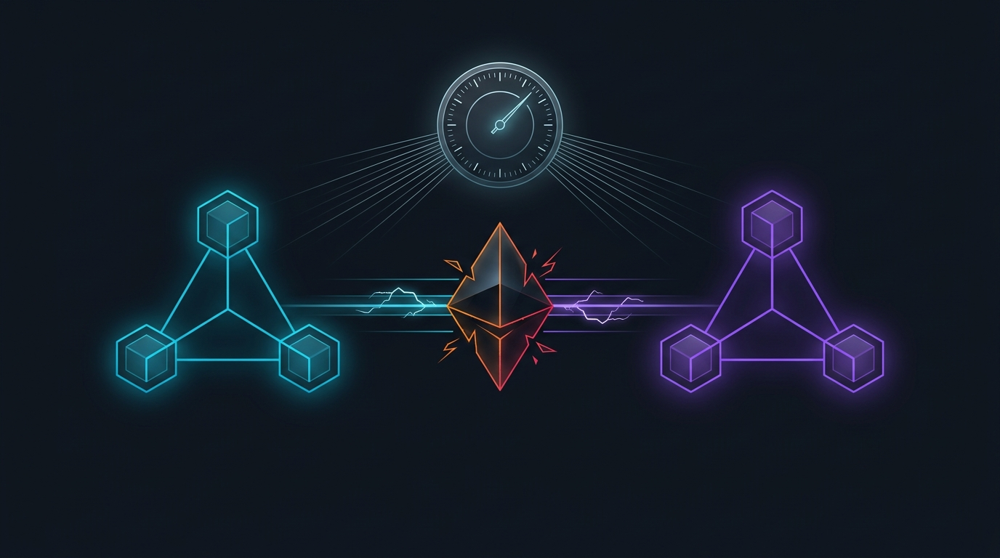
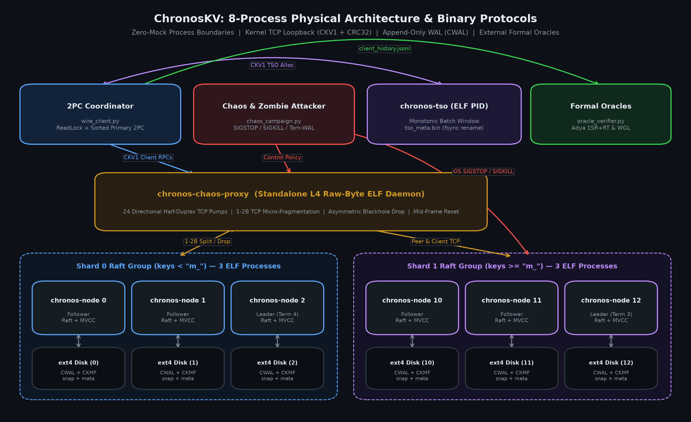
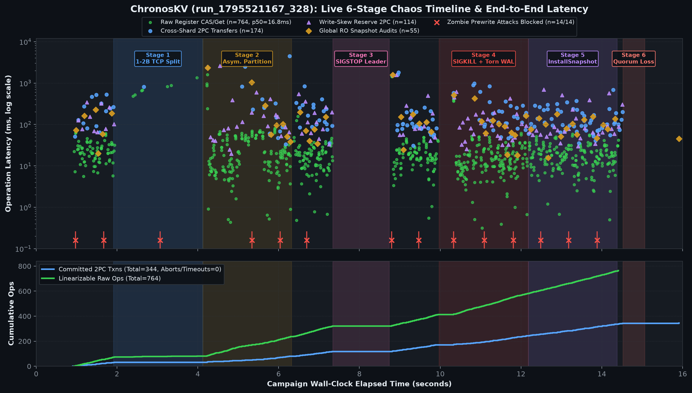
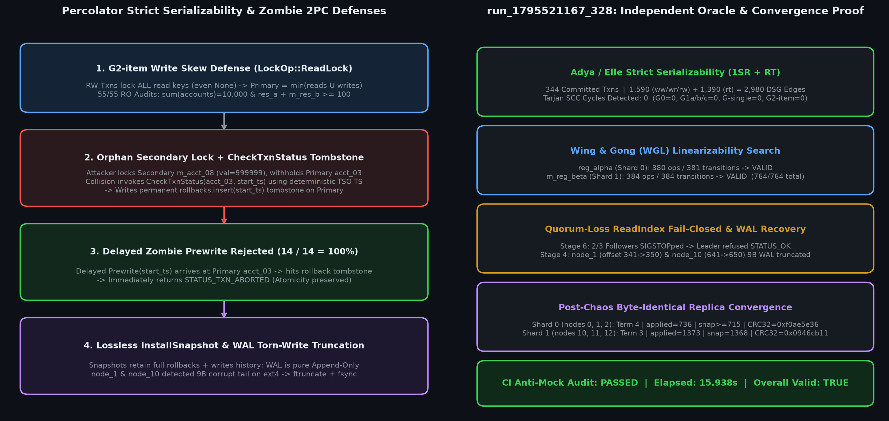

<div align="center">



# ChronosKV

**Zero-Mock Multi-Shard Raft + Strict-Serializable Percolator MVCC Distributed Storage Engine & L4 Chaos Verification Suite**

[-orange.svg)](Cargo.toml)
[-blue.svg)](src/mvcc.rs)
[](runs/run_1795521167_328/campaign_summary.json)
[](LICENSE)

[📖 **전체 기술 아티클 읽기 (`run_1795521167_328` 6단계 카오스 검증 심층 분석)**](docs/ARTICLE_CHAOS_DEEP_DIVE.md)

</div>

---

## Overview

**ChronosKV**는 인메모리 시뮬레이션이나 목업(`Mock`/`Fake`)을 완전히 배제하고, **실제 8개의 독립 Linux ELF OS 프로세스**, **커널 TCP 루프백 소켓 위 자체 바이너리 와이어 프로토콜(`CKV1` + IEEE CRC32)**, **순수 Append-Only 디스크 WAL(`CWAL` + `fsync` + Torn-Write 복구)**, 그리고 **외부 블랙박스 L4 TCP 카오스 프록시 & 수학적 오라클(Adya/Elle + Wing & Gong)**까지 밑바닥부터 구현·검증한 분산 트랜잭션 스토리지 엔진입니다.

> **Why Zero-Crate Pure Rust?**
> 합의 엔진(`Raft`), 바이너리 프레이밍(`CKV1`), 크래시 세이프 스토리지(`CWAL`/`CKMF`), L4 바이트 분할 프록시를 외부 비동기 프레임워크나 DB 크레이트 없이 `std`만으로 직접 구현하여, 프로토콜 경계와 커널 I/O 동작을 바이트 단위까지 투명하게 검증할 수 있습니다.

---

## System Architecture (8 Independent OS Processes)



| Component | Binary / Script | Role |
|---|---|---|
| **Timestamp Oracle** | `chronos-tso` (`src/bin/chronos_tso.rs`) | 배치 윈도우 사전 할당 + 4단계 원자적 교체(`staging -> fsync -> rename -> dir fsync`)로 `SIGKILL` 이후에도 단조 증가 보장 |
| **L4 Chaos Proxy** | `chronos-chaos-proxy` (`src/bin/chronos_chaos_proxy.rs`) | 24개 방향별 반이중(Half-Duplex) TCP 펌프 — `1~2B` TCP 조각 분할, 비대칭 단방향 블랙홀, 소켓 강제 리셋 주입 |
| **Storage Nodes (×6)** | `chronos-node` (`src/bin/chronos_node.rs`) | 2샤드 × 3복제본 — `PreVote`, `CheckQuorum`, 리더 `NoOp`, Lease-free `ReadIndex`, 다중 청크 `InstallSnapshot`, `Strict Serializable` Percolator MVCC |
| **2PC Coordinator** | `harness/wire_client.py` | `CKV1` 바이너리 코덱 기반 `ReadLock` 포함 2PC(`Primary = min(reads ∪ writes)` 고정) 및 `CheckTxnStatus` 고아 락 복구 |
| **Formal Oracles** | `harness/oracle_verifier.py` | Adya/Elle 의존성 그래프(`ww ∪ wr ∪ rw ∪ rt`) Tarjan SCC 사이클 탐지 + 단일 키 Wing & Gong(WGL) 선형성 검증 |

---

## `run_1795521167_328` 6-Stage Chaos Verification Highlights

실제 8개 네이티브 ELF 프로세스 위에서 `15.938초` 동안 동시 크로스-샤드 2PC 이체, `G2-item` Write-Skew 공격, 고아 락 Zombie `Prewrite` 공격, 단일 키 선형성 `RawCas`/`RawGet` 트래픽을 쏟아부으며 **6단계 물리 결함**을 주입했습니다.





### Key Verified Metrics (`runs/run_1795521167_328/campaign_summary.json`)

- **Strict Serializability (`Adya / Elle 1SR + Real-Time`)**: 커밋 트랜잭션 `344`건, 의존성/실시간 간선 `2,980`개(`1,590` `1SR` + `1,390` `rt`)에서 **Tarjan SCC 사이클 `0`건**
- **Cross-Shard Invariants**: 전역 Read-Only 스냅샷 감사 `55 / 55`회 모두 계좌 총액 `10,000` 보존 및 준비금 불변식(`res_a + m_res_b >= 100`) 준수 (`G2-item` Write Skew `0`건)
- **Zombie `Prewrite` Defense**: 고아 락 유도 후 지연 발사된 Zombie Primary `Prewrite` **`14 / 14` (`100%`) `STATUS_TXN_ABORTED` 차단**
- **Wing & Gong (WGL) Linearizability**: `reg_alpha` `380`건 + `m_reg_beta` `384`건 = **`764 / 764` 연산 선형화 통과**
- **Crash & Torn-WAL Recovery**: `SIGKILL` 후 ext4 `raft_wal.log` 끝 `9B` 손상 주입 → `node_1` (`341->350`) 및 `node_10` (`641->650`) 부팅 시 자동 `ftruncate` 복구 및 `InstallSnapshot` 추격
- **Byte-Identical Replica Convergence**:
  - Shard 0 (`node 0, 1, 2`): `last_applied = 736`, `state_crc32 = 0xf0ae5e36` 3노드 전원 일치
  - Shard 1 (`node 10, 11, 12`): `last_applied = 1373`, `state_crc32 = 0x0946cb11` 3노드 전원 일치

---

## Quick Start & Independent Reproduction

### 1. Build Native Release Binaries & Run Unit Tests (Linux / WSL2)
```bash
cargo test
cargo build --release
mkdir -p bin
cp target/release/chronos-tso target/release/chronos-node target/release/chronos-chaos-proxy bin/
```

### 2. Independently Re-Verify `run_1795521167_328` Artifacts
저장소에 포함된 원본 트랜잭션 히스토리(`318 KB`)를 외부 수학적 오라클로 직접 재검증할 수 있습니다.
```bash
python3 harness/ci_audit.py
python3 harness/oracle_verifier.py --self-test
python3 harness/oracle_verifier.py --history runs/run_1795521167_328/client_history.jsonl
```

### 3. Run a Fresh 8-Process Live 6-Stage Chaos Campaign
```bash
python3 harness/chaos_campaign.py
```

---

## Repository Layout

```text
chronos_kv/
├── Cargo.toml                         # Pure-Rust workspace (overflow-checks = true in release)
├── src/
│   ├── crc32.rs                       # IEEE 802.3 CRC32 (0xEDB88320)
│   ├── wire.rs                        # CKV1 24-byte header framing + incremental FrameDecoder
│   ├── protocol.rs                    # Binary RPC codecs (TSO, Raft, Percolator, RawCas, Chaos)
│   ├── storage.rs                     # Append-Only CWAL (TruncateAfter + Torn-Write ftruncate) & CKMF atomic rename
│   ├── mvcc.rs                        # Strict-Serializable Percolator MVCC + CheckTxnStatus tombstones
│   ├── raft.rs                        # Multi-Group Raft (PreVote, CheckQuorum, NoOp, ReadIndex, InstallSnapshot)
│   └── bin/
│       ├── chronos_tso.rs             # Standalone Monotonic TSO daemon
│       ├── chronos_node.rs            # Standalone Raft + MVCC storage node daemon
│       └── chronos_chaos_proxy.rs     # Standalone L4 directional TCP chaos proxy daemon
├── harness/
│   ├── wire_client.py                 # Binary CKV1 coordinator & 2PC client
│   ├── chaos_campaign.py              # 8-process 6-stage black-box chaos orchestrator
│   ├── oracle_verifier.py             # Adya/Elle 1SR+RT SCC & WGL linearizability verifier
│   └── ci_audit.py                    # Static Anti-Mock & ELF/socket/fsync boundary auditor
├── docs/
│   ├── ARTICLE_CHAOS_DEEP_DIVE.md     # Full technical article analyzing run_1795521167_328
│   └── images/                        # Hero banner, architecture, chaos timeline, & verification figures
└── runs/
    └── run_1795521167_328/            # Complete logs, chaos timeline, raw JSONL history, and summary
```

## License

This project is licensed under the [MIT License](LICENSE).
