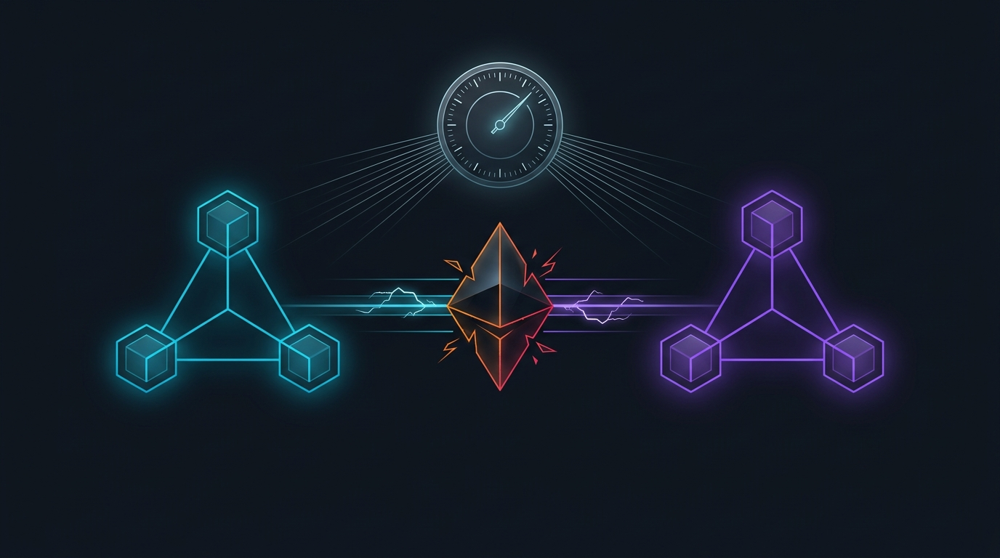
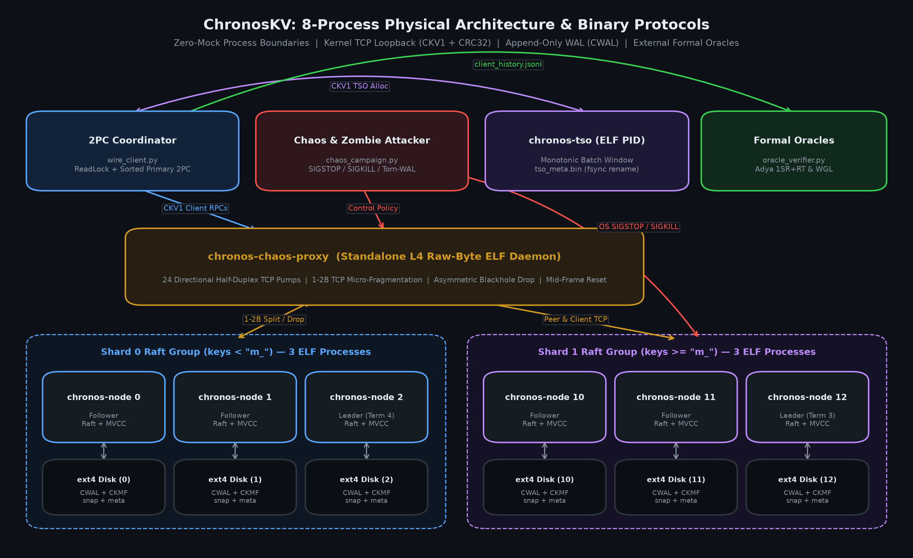
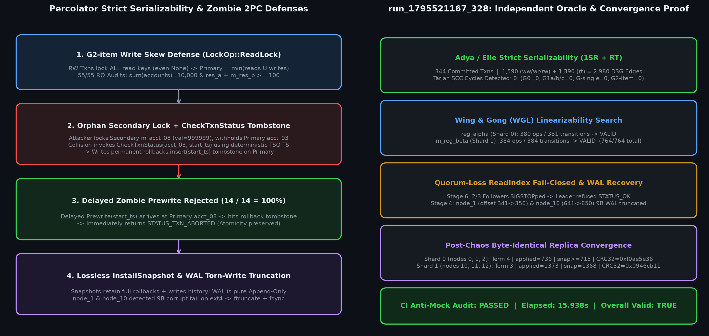
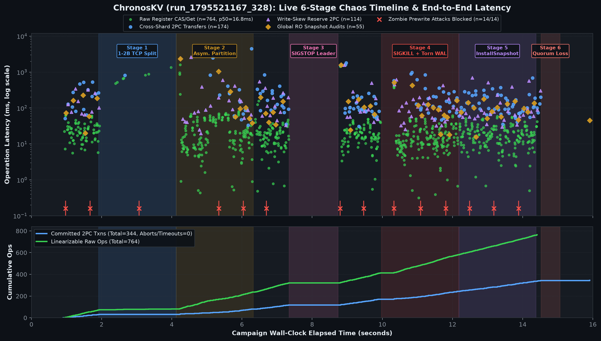

# 8개의 실제 OS 프로세스와 L4 TCP 카오스 프록시로 검증한 분산 트랜잭션 엔진: `ChronosKV` (`run_1795521167_328` 심층 기술 아티클)



분산 데이터베이스를 직접 구현할 때 가장 빠지기 쉬운 함정은 **인메모리 시뮬레이션의 착시**다. 단일 프로세스 메모리 안에서 `dict`나 채널 객체로 노드를 흉내 내고, 코드 내부에 `if inject_bug:` 플래그를 심어 테스트를 통과시키면, 실제 커널 TCP 스택의 바이트 분할이나 `SIGSTOP` 프로세스 동결, 디스크 `fsync` 전 `SIGKILL`에 의한 Torn-Write 앞에서는 단 몇 초 만에 정합성이 무너진다.

**ChronosKV**는 처음부터 **Zero-Mock 물리 경계 원칙** 아래 설계된 **Multi-Shard Raft + Strict-Serializable Percolator MVCC 분산 스토리지 엔진**이다. 외부 크레이트 없이 순수 Rust(`std`)만으로 3종류의 네이티브 Linux ELF 데몬을 빌드해 총 **8개의 독립 OS 프로세스**를 띄우고, 외부 L4 바이트 카오스 프록시와 OS 시그널 폭격 속에서 외부 수학적 오라클(Adya/Elle & Wing & Gong)로 정합성을 증명했다.

이 아티클에서는 실제 카오스 검증 실행인 **`run_1795521167_328`** 의 설계 원리, 6단계 결함 주입 과정, 그리고 부팅 오버플로 버그 추적부터 최종 바이트 수렴까지 전 과정을 정리한다.

---

## 1. 8-프로세스 물리 아키텍처와 바이너리 경계



클러스터는 공유 메모리 없이 오직 커널 TCP 루프백(`127.0.0.1`)과 ext4 파일 디스크립터를 통해서만 상호작용하는 8개의 독립 프로세스로 구성된다.

1. **`chronos-tso` (1개 프로세스)**: 배치 윈도우(`--batch-window 250`) 단위로 타임스탬프를 사전 할당하고, `tso_meta.bin.staging -> fsync -> rename -> dir fsync` 4단계 원자적 교체로 `SIGKILL` 재기동 후에도 타임스탬프 단조 증가를 물리적으로 보장한다.
2. **`chronos-chaos-proxy` (1개 프로세스)**: 클라이언트-노드 및 노드-노드 사이의 **24개 방향별 TCP 링크**를 반이중(Half-Duplex)으로 중계하는 외부 L4 결함 주입기다. 런타임 제어 RPC(`MSG_CHAOS_SET_POLICY_REQ`)를 받아 특정 방향만 패킷을 삼키거나(비대칭 파티션), 모든 스트림을 **1~2바이트 단위로 난도질(TCP Micro-Fragmentation)**한다.
3. **`chronos-node` (6개 프로세스)**: Shard 0(`0, 1, 2`)과 Shard 1(`10, 11, 12`) 두 개의 3노드 Raft 그룹을 실행한다.

### 와이어 & 디스크 바이너리 포맷
- **TCP 와이어 프레임 (`CKV1`, [src/wire.rs](../src/wire.rs))**:
  ```text
  [magic: "CKV1" 4B][version: 1B][msg_type: 1B][flags: 2B LE][req_id: 8B LE][payload_len: 4B LE][crc32: 4B LE][payload: N bytes]
  ```
  `FrameDecoder`가 연결별 누적 버퍼를 유지하므로 4바이트 길이 헤더조차 1바이트씩 쪼개져 도착해도 완벽하게 재조립하며, IEEE 802.3 CRC32 불일치 시 즉시 해당 소켓을 절단한다.
- **순수 Append-Only WAL (`CWAL`, [src/storage.rs](../src/storage.rs))**:
  리더 교체 후 충돌 로그를 덮어쓰다가 `SIGKILL`을 맞으면 옛 Term과 새 Term 로그가 뒤섞이는 참사를 막기 위해, 로그 절단 자체를 `WAL_REC_TRUNCATE_AFTER` 프레임으로 뒤에 추가한다. 부팅 시 첫 번째 CRC32 불일치 또는 불완전 프레임을 만나면 직전 정상 경계로 `ftruncate` + `fsync`를 수행한다.

---

## 2. 카오스에서 살아남기 위해 잠근 5가지 핵심 설계 규약



1. **Snapshot Isolation → `Strict Serializability (1SR + Real-Time)` 격상**:
   순수 Percolator는 서로 다른 키를 교차 읽고 쓰는 Write Skew(`G2-item`)를 허용한다. ChronosKV는 Read-Write 트랜잭션이 읽은 모든 키(존재하지 않는 `None` 키 포함)에 `LockOp::ReadLock`을 함께 `Prewrite`하고, `min(reads ∪ writes)`를 `Primary`로 고정해 Primary 샤드를 가장 먼저 Prewrite함으로써 Write Skew를 원천 차단한다.
2. **고아 락 복구 시 Zombie `Prewrite` 봉쇄**:
   Secondary 락만 걸리고 Primary `Prewrite`가 네트워크에 지연된 사이, 타 트랜잭션이 `CheckTxnStatus`로 Primary 부재를 확인하고 Secondary 락을 지운 뒤 뒤늦게 Primary `Prewrite`가 도착하면 부분 커밋이 발생한다. 이를 막기 위해 `CheckTxnStatus`가 롤백을 판정할 때 Primary의 `rollbacks` 집합에 영구 `start_ts` 톰스톤을 기록하고, 모든 `Prewrite`가 실행 전 `rollbacks`를 검사해 즉시 `STATUS_TXN_ABORTED`로 거절한다.
3. **Raft `apply()` 내부 OS 벽시계 금지**:
   Lock TTL 만료 판정을 노드의 로컬 `Instant`로 계산하면 `SIGSTOP`이나 지연 시 상태 머신이 분기한다. `CheckTxnStatus` 커맨드 자체에 TSO 논리 타임스탬프(`caller_current_ts`)를 실어 Raft 로그에 기록함으로써 모든 복제본이 결정적으로 동일한 TTL 판정을 내린다.
4. **좀비 리더 방어 (`PreVote` + `CheckQuorum` + `NoOp` + Lease-free `ReadIndex`)**:
   새 리더는 현재 Term의 `NoOp` 엔트리를 과반 커밋하기 전까지 `ReadIndex`를 서빙하지 않는다. 읽기 요청 시마다 고유 `read_ctx_id`를 태깅한 새 하트비트 라운드의 과반 응답과 `last_applied >= target_read_index`를 확인하므로 `SIGSTOP`으로 1.4초 멈췄다 깨어난 좀비 리더도 절대 구 데이터를 반환할 수 없다.
5. **무손실 `InstallSnapshot` & 선 스냅샷 후 WAL 절단**:
   `rollbacks`와 `writes` 히스토리를 스냅샷에 무손실 직렬화해 스냅샷 이후 도착한 지연 RPC에서도 Zombie Prewrite를 차단하며, 반드시 스냅샷의 4단계 원자적 저장이 끝난 뒤에만 WAL을 컴팩션한다.

---

## 3. 실전 디버깅 사례: `overflow-checks = true`가 잡아낸 부팅 패닉

[Cargo.toml](../Cargo.toml)의 `[profile.release]`에 `overflow-checks = true`를 활성화해 둔 상태에서 첫 8-프로세스 기동을 실행했을 때, `node_0`만 생존하고 `node_1..12`가 부팅 직후 종료되는 현상이 발생했다. 데몬 로그(`node_1.log`)를 확인하자 범인이 즉시 드러났다:

```text
thread 'main' panicked at src/raft.rs:1050:37:
attempt to multiply with overflow
```

피보나치 해싱 상수 `0x9E37_79B9_7F4A_7C15`($\lfloor 2^{64}/\phi \rfloor$)에 `(node_id as u64 + 1)`을 곱할 때 `node_id = 0`에서는 인수가 `1`이라 통과했지만, `node_id >= 1`이 되는 순간 $2^{64}$를 초과하며 릴리스 모드에서도 산술 오버플로를 포착한 것이다. 의도적 해시 시드 계산만 `.wrapping_mul()`로 명시하고 시간 차감 역시 `saturating_duration_since`로 보완한 뒤 재빌드하여 8개 프로세스 전원을 정상 기동했다.

---

## 4. `run_1795521167_328`: 6단계 실시간 카오스 캠페인 해부



캠페인은 `15.938초` 동안 백그라운드에서 **4개의 크로스-샤드 계좌 이체 스레드**, **2개의 Write-Skew(`G2-item`) 공격 스레드**, **1개의 전역 Read-Only 스냅샷 감사 스레드**, **4개의 단일 키 `RawCas`/`RawGet` 스레드**, 그리고 **1개의 고아 락 Zombie `Prewrite` 공격 스레드**가 동시에 가동되는 가운데 아래 6단계 카오스를 순서대로 투하했다.

### Stage 1 (`1.91s ~ 4.12s`) — 전 링크 1~2바이트 L4 TCP 마이크로 분할
* **주입**: `chronos-chaos-proxy` 제어 RPC로 24개 전 방향 TCP 링크에 `max_chunk_bytes = 2, delay_ms = 1` 적용.
* **관찰**: 헤더(24B)조차 최소 12번 이상 쪼개져 커널 소켓에 도착하는 극한 환경에서도 CRC32 오류나 프레임 유실 없이 다중 샤드 2PC가 커밋되었다.

### Stage 2 (`4.12s ~ 6.32s`) — 비대칭 단방향 네트워크 파티션
* **주입**: Shard 0 리더(`node 0`)에 대해 `n0 -> n1` 단방향만 열어두고 `n1 -> n0` 및 `n0 <-> n2`를 블랙홀 차단.
* **관찰**: `node 0`의 피어 채널이 차도 Raft 메인 루프가 블로킹되지 않고 `CheckQuorum`으로 스스로 강등되었으며, `node 1`·`node 2`가 `PreVote`를 거쳐 새 리더를 선출해 Stale Read 0건으로 서비스를 지속했다.

### Stage 3 (`7.34s ~ 8.74s`) — `SIGSTOP` 좀비 리더 1.4초 동결 및 해동
* **주입**: Shard 1 리더(`node 11`, PID `466`)에 OS 시그널 `SIGSTOP`을 1.4초간 투하 후 `SIGCONT`로 재개.
* **관찰**: 멈춰 있던 좀비 리더가 로컬 타이머(Lease)에 속아 구 버전을 읽지 않고, 즉시 `ReadIndex`와 Term 상승으로 질서를 회복했다.

### Stage 4 (`9.97s ~ 12.18s`) — `SIGKILL` 암살 + ext4 디스크 WAL Torn-Write 주입
* **주입**: `chronos-tso`, Shard 0 리더(`node 1`), Shard 1(`node 10`)을 `SIGKILL`로 강제 사살한 뒤, 두 노드의 실제 ext4 `raft_wal.log` 파일 끝에 불완전한 9바이트(`CWAL\xde\xad\xbe\xef\x99`)를 append + `fsync`하고 재기동.
* **원본 로그 증거** ([node_1.log](../runs/run_1795521167_328/node_1.log), [node_10.log](../runs/run_1795521167_328/node_10.log)):
  ```text
  node_1:  [WAL-RECOVERY] dir=/tmp/chronos_ext4_run_1795521167_328/node_1 detected torn/corrupt WAL tail at offset 341 (file_len=350); truncating 9 bytes
  node_1:  [node 1 shard 0] Boot recovery: snap_idx=390, wal_entries=4, torn_bytes_truncated=9
  node_10: [WAL-RECOVERY] dir=/tmp/chronos_ext4_run_1795521167_328/node_10 detected torn/corrupt WAL tail at offset 641 (file_len=650); truncating 9 bytes
  node_10: [node 10 shard 1] Boot recovery: snap_idx=718, wal_entries=7, torn_bytes_truncated=9
  ```
* `chronos-tso` 역시 재기동 후 디스크 `tso_meta.bin`의 `allocated_max_ts + 1`로 점프하여 Real-Time 역전이 발생하지 않았다.

### Stage 5 (`12.18s ~ 14.38s`) — `InstallSnapshot` 추격 & 14연속 Zombie `Prewrite` 방어
* **스냅샷 컴팩션 추격**: `node 1`이 오프라인인 동안 Shard 0이 `snap_idx = 715` 이상으로 WAL을 컴팩션하게 만든 뒤 `node 1`을 재기동하여 다중 청크 `InstallSnapshot` RPC로 최신 인덱스 `736`까지 완벽히 따라잡았다.
* **Zombie 2PC 공격 방어**: 공격 스레드가 Secondary(`m_acct_08`)에만 `999999` 값의 고아 락을 심고 Primary(`acct_03`)를 지연시킨 뒤 `CheckTxnStatus` 후 뒤늦게 Primary `Prewrite`를 발사하는 공격을 **14회** 반복했으나, **14/14 전량 `STATUS_TXN_ABORTED`로 차단**되었다.

### Stage 6 (`14.52s ~ 15.06s`) — 정족수 상실 시 리더 `ReadIndex` Fail-Closed 검증
* **주입**: Shard 0 리더(`node 0`)를 제외한 두 팔로워(`node 1`, `node 2`)를 동시에 `SIGSTOP`으로 정지시킨 상태에서 `node 0`에 직접 `ClientReadReq` 전송.
* **관찰**: 과반수 하트비트 응답을 받지 못한 `node 0`가 `STATUS_OK` 반환을 거부(Fail-Closed)했고, `SIGCONT` 복구 후 즉시 정상 수렴했다.

---

## 5. 외부 독립 오라클 검증 및 바이트 단위 상태 수렴

모든 클라이언트 입출력 이력이 기록된 [client_history.jsonl](../runs/run_1795521167_328/client_history.jsonl)(`318,542 B`)을 외부 오라클([oracle_verifier.py](../harness/oracle_verifier.py))로 사후 검증한 결과는 다음과 같다.

| 검증 항목 | 측정 수치 (`run_1795521167_328`) | 판정 |
|---|---|---|
| **다중 샤드 트랜잭션** | 이체 `174`건 + 준비금 인출/보충 `114`건 + 전역 읽기 감사 `55`건 + 초기화 `1`건 = **`344`건 커밋** (타임아웃/유실 `0`) | **PASS** |
| **계좌 총액 & Write-Skew 불변식** | `55 / 55` 전역 감사 모두 `sum(accounts) = 10,000`, `res_a + m_res_b >= 100` (`G2-item = 0`) | **PASS** |
| **Adya / Elle `Strict Serializability`** | `ww/wr/rw` 간선 `1,590`개 + Real-Time(`rt`) 간선 `1,390`개 = **`2,980`개 간선에서 Tarjan SCC 사이클 `0`건** | **PASS** |
| **Wing & Gong (WGL) 선형성** | `reg_alpha` `380`건(`381` 상태 전이) + `m_reg_beta` `384`건(`384` 상태 전이) = **`764 / 764`건 선형화 가능** | **PASS** |
| **복제본 바이트 수렴 (`state_crc32`)** | Shard 0 (`0, 1, 2`): `last_applied=736`, **`0xf0ae5e36`** 일치 / Shard 1 (`10, 11, 12`): `last_applied=1373`, **`0x0946cb11`** 일치 | **PASS** |

---

## 6. 설계 범위와 명시적 한계점 (Engineering Honesty)

본 프로젝트는 핵심 합의·트랜잭션 정합성과 물리 장애 복구의 엄밀성을 입증하는 데 집중했으며, 상용 프로덕션 수준의 운영 기능을 위해 다음 3가지는 의도적 범위 한계로 남아 있다.

1. **단일 크래시 세이프 TSO**: `chronos-tso`는 `SIGKILL` 재기동 시 타임스탬프 단조성을 잃지 않지만, 자체 Raft 복제 그룹으로 구성된 무중단 HA(High Availability) 서비스는 아니다.
2. **무손실 MVCC 히스토리 유지 (GC 미구현)**: `InstallSnapshot` 시 Zombie Prewrite 방어를 위해 `writes` 및 `rollbacks` 톰스톤 전체를 유지하므로, 장기 연속 운영을 위해서는 글로벌 Safe-Point 워터마크 기반의 MVCC 가비지 컬렉션(GC) 확장이 필요하다.
3. **정적 키 범위 샤딩**: 현재 키 라우팅은 정적 경계(`key < "m_"` vs `>= "m_"`)를 사용하며 동적 Region Split/Merge는 포함하지 않는다.
